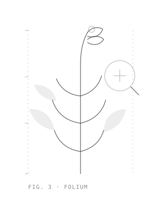

# About

I'm Selja Keränen, an AI engineer in Helsinki. I build production AI systems —
and I pay attention to the part most demos skip, which is what happens once real
users get hold of the thing and start doing what nobody planned for.

<figure markdown="span">
  { width="240" loading="lazy" }
  <figcaption>Fig. — a specimen, pressed and measured</figcaption>
</figure>

Most of my work is the full path from an idea to something running in
production: RAG pipelines, document extraction from messy technical documents,
agentic workflows, and the evaluation work that keeps them honest. I build what
I design, and I'd rather ship something simple that works than something clever
I can't maintain.

## What I keep coming back to

- **From proof of concept to production.** The demo is the easy part. Making a
  genAI system reliable enough to put in front of real users, and keeping it
  that way, is the actual job.
- **Evals before prompts.** Define what "good" means and build a golden set with
  the people who know the domain, before tuning anything.
- **Document-heavy workflows.** Turning specs, contracts, drawings and logs into
  outputs a business can actually trust.
- **AI-native ways of working.** How teams and coding agents split the work, and
  how you structure knowledge so it compounds across projects.

## Elsewhere

I write here in the [journal](blog/index.md), keep code on
[GitHub](https://github.com/SeljaKeranen), and post occasionally on
[LinkedIn](https://www.linkedin.com/in/selja-ker%C3%A4nen-95b4b1150/).

If you're working on something in this space, or just want to compare notes,
[send me a message](mailto:seljaww@gmail.com).
